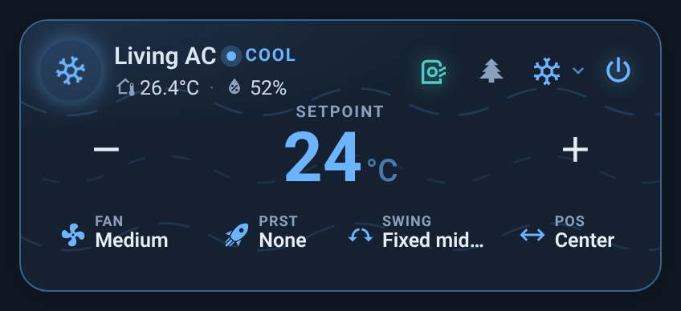
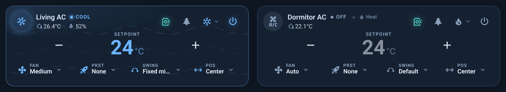
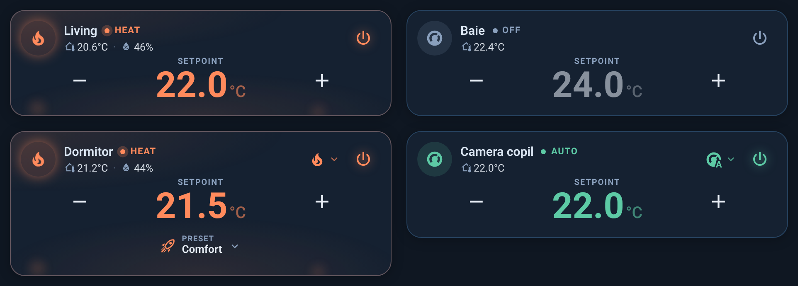
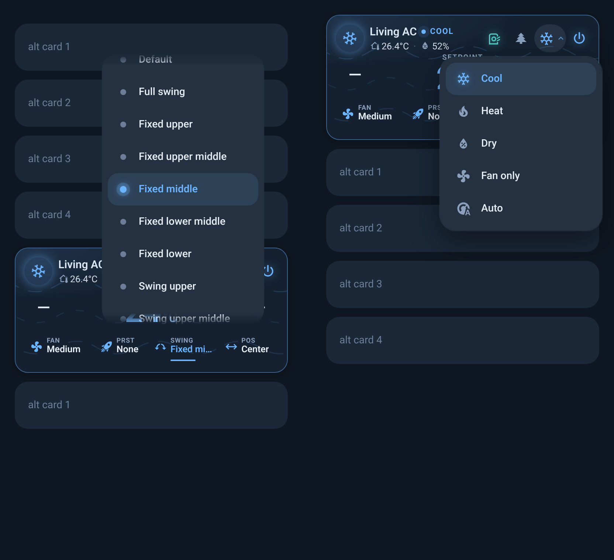

# Thermostat Card

An animated Home Assistant Lovelace card for **air conditioners and thermostats**.
It works like a remote control: one power button that resumes the last mode, a mode
dropdown next to it, your extra switches (ionizer, eco, sleep…), a large setpoint and
Bubble-style selectors for fan, preset and swing. It uses the same visual style as
[EBusD Clas One Card](https://github.com/phateks/EBusD-ClasONE-card) and
[Energy Flow Card](https://github.com/phateks/Energy-Flow-card).

<p align="center"></p>

<p align="center">
  <a href="https://my.home-assistant.io/redirect/hacs_repository/?owner=phateks&amp;repository=thermostat&amp;category=plugin"></a>
</p>

## Contents

- [Features](#features)
- [Installation](#installation)
- [Configuration](#configuration)
- [How the controls behave](#how-the-controls-behave)
- [YAML reference](#yaml-reference)
- [Releasing a new version](#releasing-a-new-version)

## Features

<p align="center"></p>

- **Remote-style power button** in the top-right corner. It switches the unit off and
  back on **in the last mode it was running** (cool, heat, dry…), without asking which
  mode to use.
- **Mode dropdown** next to the power button, shown only when the entity has more
  than one mode besides `off`. The active mode is shown next to the name, in its colour.
- **Extra toggles** for any `switch`, `input_boolean`, `light` or `fan` entity,
  shown as bare icons that light up when on. Hold one to open its more-info dialog.
- **Large setpoint** with − / + buttons. Taps are combined and sent once (0.7 s after
  the last tap); the value stays dimmed until the device confirms it. `heat_cool`
  entities get a MIN and a MAX setpoint.
- **Selectors** for fan mode, preset, vertical and horizontal swing, or any `select` /
  `input_select` entity, all on one line, even on a phone.
- **Floating dropdowns** like Bubble Card: they open towards the side of the screen with
  more room, show up to 8 options and scroll inside without a visible scrollbar.
- **Animations**: the icon flickers when heating, spins when cooling or on fan, and
  bobs when drying. Airflow lines move across the background faster or slower with the
  fan speed. The whole card takes the colour of the current mode.
- **Visual editor** for everything: entity, room sensors for temperature and humidity,
  power behaviour, switches, selectors, option labels and colours.
- **No inner boxes**, light and dark theme support, `prefers-reduced-motion` support and
  automatic layout for phone, tablet and desktop widths.

<p align="center"></p>

<p align="center"></p>

## Installation

### HACS (recommended)

1. Click the **Open in HACS** button above, or in HACS open the three-dot menu →
   **Custom repositories** and add `https://github.com/phateks/thermostat` with type
   **Dashboard**.
2. Search for **Thermostat Card** in HACS and download it.
3. Reload the browser (on the mobile app: Settings → Companion app → Debugging →
   Reset frontend cache).

HACS adds the dashboard resource for you.

### Manual

1. Download `thermostat-card.js` from the
   [latest release](https://github.com/phateks/thermostat/releases/latest).
2. Copy it to `/config/www/thermostat-card.js`.
3. Add it as a dashboard resource:

   [](https://my.home-assistant.io/redirect/lovelace_resources/)

   URL `/local/thermostat-card.js`, type **JavaScript module**.
4. Reload the browser.

## Configuration

Everything is set up in the **visual editor**. No YAML is needed.

1. Edit a dashboard → **Add card** → search for **Thermostat Card**.
2. Pick the **climate entity**. The card fills in the rest from the entity:
   - a power button when the entity has an `off` mode;
   - a mode dropdown when it has more than one mode besides `off`;
   - selectors for the attributes the entity supports: fan mode, preset, swing and
     horizontal swing for air conditioners, and preset for thermostats.
3. Adjust what you need:

| Editor section | What you can set |
| --- | --- |
| Top | Entity, name, icon, an optional **temperature sensor** and **humidity sensor** from any other entity (for example a room sensor, when the climate entity reports none), card type (automatic / air conditioner / thermostat), what the power button turns on (last mode, the integration's choice, or always one mode), mode dropdown (automatic / show / hide), animations, and the items in the line under the name. |
| Header buttons | Add switches for `switch`, `input_boolean`, `light`, `fan`, `script` or `automation` entities, with icons for on and off, a colour, and an option to show the name with a small switch. Add or remove the power button. Reorder or remove buttons. |
| Selectors | Add, reorder or remove selectors for fan mode, preset, vertical or horizontal swing, HVAC mode, or a `select` / `input_select` entity. Choose which options appear and give each option your own label (for example `fixed_middle` → `Middle`). |
| Colors | A colour per mode and the default colour of switches that are on (optional). |

The power button is always drawn in the top-right corner, whatever its place in the
list.

### Height

With no height set, the card takes its natural, compact height. Give it a height by
resizing the card in a Sections dashboard (or with the `height` option): the
header and the selector row keep their size, and only the setpoint area in the middle
grows or shrinks. When it gets small, the `SETPOINT` label is hidden first, then the
number gets smaller. With even less height (for example 2 rows in a Sections
dashboard), the card switches to a compact layout like Bubble Card: `− 24 °C +` moves
into the header next to the buttons, and the card still fits its space without
overlapping the card below.

## How the controls behave

- **Power**: when the unit is on, the button calls `climate.turn_off`. When it is off,
  the button calls `climate.set_hvac_mode` with the last mode the card saw the unit
  running in, like a remote control. The card stores that mode in the browser, per
  entity, so it survives page reloads. Until a browser has seen the unit running once,
  it falls back to `climate.turn_on`. You can change this in the editor ("Power button turns the unit on in").
- **Mode dropdown while off**: choosing a mode does not switch the unit on. It only
  selects the mode the power button will start in, and the title shows it as
  `OFF → Heat`.
- **Dropdowns**: a selector in the upper half of the screen opens its list downwards,
  one in the lower half opens it upwards. The list grows up to 16 px from the edge of
  the screen and shows at most 8 options (adjustable in the editor); the rest scroll. Picking an
  option applies it right away and closes the list. A click outside or Esc also
  closes it.
- **Setpoint**: taps are combined and sent once, 0.7 s after the last tap by default. The value is
  dimmed until the device reports it back; if that does not happen within about
  8 seconds, the card shows the device value again.
- **More info**: click the round icon next to the name, or hold a switch.

## YAML reference

The editor writes the same options to YAML; you never need to edit it by hand.

<details>
<summary>All options</summary>

| Option | Default | Description |
| --- | --- | --- |
| `entity` | — | `climate.*` entity. **Required.** |
| `name`, `icon` | entity | Title and the icon shown while idle or off. |
| `preset` | auto | `ac` or `thermostat`: default icon and selectors. |
| `power_on` | `last` | `last`, `turn_on` or a mode such as `cool`. |
| `mode_dropdown` | auto | `true` / `false`. |
| `switches` | power | `{ type: power }` or `{ entity, name, icon, icon_off, color, show_name }`. |
| `selects` | from the entity | `{ type }` (`fan_mode`, `preset_mode`, `swing_mode`, `swing_horizontal_mode`, `hvac_mode`) or `{ entity }`, with `name`, `icon`, `options`, `labels`, `icons`, `show_value`. |
| `temperature_entity`, `humidity_entity` | — | Sensors shown in the line under the name instead of the climate's own values. A sensor that is set is always shown. |
| `info` | current temperature, humidity | `current_temperature`, `humidity`, `hvac_action`, `state`, `fan_mode`, `preset_mode`, `target_temperature`. |
| `height` | automatic | Card height in px (or any CSS length). Only the setpoint area adapts. |
| `step`, `decimals`, `unit` | entity | Setpoint step, decimals and unit text. |
| `buttons_size` | `large` | `small`, `medium`, `large`, `xlarge`. |
| `debounce` | `700` | Milliseconds before the setpoint is sent. |
| `menu_max_items` | `8` | Options visible in a dropdown before it scrolls. |
| `modes`, `hide_modes` | — | Optional mode buttons row. |
| `animations` | `true` | `false` turns animations off. |
| `theme.modes`, `theme.switch_on` | — | Colour per mode and for switches that are on. |

```yaml
type: custom:thermostat-card
entity: climate.living_ac
switches:
  - entity: switch.living_ac_ionizer
    icon: mdi:air-purifier
  - entity: switch.living_ac_eco
    icon: mdi:pine-tree
    color: "#5dcaa5"
  - type: power
selects:
  - type: fan_mode
  - type: preset_mode
    name: Prst
  - type: swing_mode
    labels:
      fixed_middle: Middle
  - type: swing_horizontal_mode
    name: Pos
```

</details>

## Releasing a new version

Releases are built by GitHub Actions. Commit and push your changes to `main`, then run
the **Release** workflow with the new version:

```bash
gh workflow run release.yml -f version=v0.2.0
```

Or use **Actions → Release → Run workflow** on GitHub. The workflow updates the version
in `package.json`, `package-lock.json` and `src/types.ts`, builds
`thermostat-card.js`, commits, tags and publishes a GitHub release with the file
attached, which HACS then offers as an update. Do not change the version by hand.

### Local build

```bash
npm install
npm run build      # thermostat-card.js
npm run watch      # rebuild on change
```

## License

[MIT](LICENSE)
